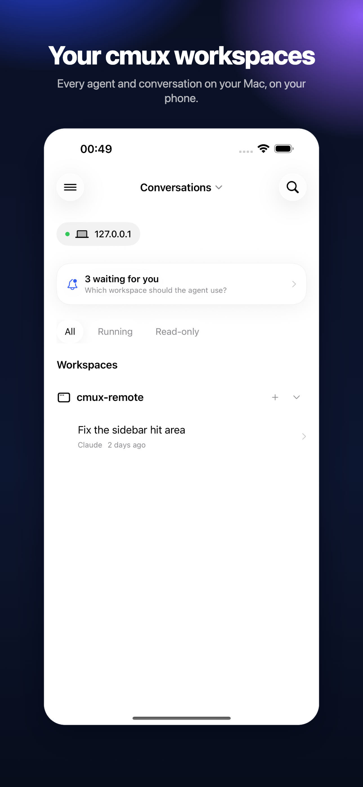
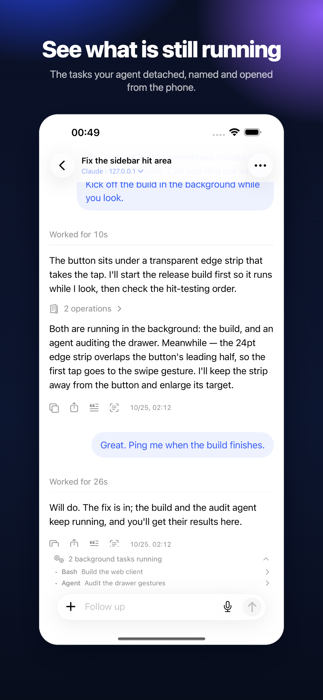
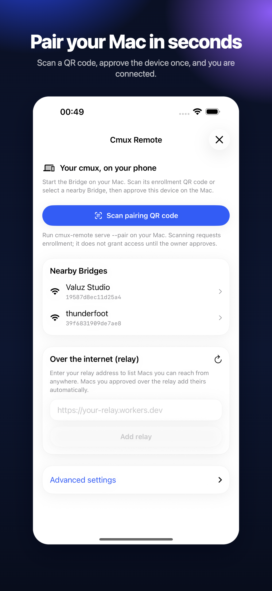

# CmuxRemote

Read, reply to and steer the coding agent running in your Mac terminal — from
your iPhone.

CmuxRemote is an independent companion for the free, open-source
[cmux](https://cmux.com) terminal. It pairs with one Mac, shows the conversation
that Mac is having, and lets you answer what the agent asks while you are away
from the desk. There is no account, no analytics, and no server run by this
project: the phone talks to your Mac over your local network, or through a
Cloudflare relay you deploy to your own account.

CmuxRemote is not an official cmux product.

<p align="center">
  
  
  
</p>

## What you get

- **Live conversation** — replies, tool calls, diffs and images as they happen.
- **Send prompts and stop work** — with the same agent and the same terminal.
- **Answer questions** — the questions and permission prompts the agent raises
  arrive as cards you can act on.
- **Background agents** — see what is still running, including agents that
  recovered after an error.
- **Switch the model** — from the conversation header, using the agent's own
  picker.
- **Images** — preview screenshots and pinch to zoom.

The phone shows structured chat data; it is not a terminal, and it never talks
to an AI provider itself. cmux keeps owning the agents and terminals.

## What you need

| | |
| --- | --- |
| Mac | macOS 14 Sonoma or later |
| cmux | the official app, installed and running |
| iPhone | iOS 18 or later |

## Install

### 1. cmux on your Mac

CmuxRemote drives the official cmux app, so install that first:

- Download: <https://cmux.com> or the [cmux repository](https://github.com/manaflow-ai/cmux)
- Open cmux once and start a session, so it creates its own socket.

### 2. CmuxRemote for Mac (the menu bar app)

- Download the latest `CmuxRemote-<version>.dmg` from
  [Releases](https://github.com/St0neWan9/cmux-remote/releases).
- Open the disk image, drag **CmuxRemote** to *Applications*, and launch it.
  It lives in the menu bar, with no Dock icon.
- The download is signed with a Developer ID and notarized by Apple. If you
  already have an older copy, quit it first and replace it.
- Verify the download against `SHA256SUMS.txt` in the same release if you like.

The app only does something once you turn on sharing — it never modifies cmux,
its socket settings, or an installed cmux copy.

### 3. The iPhone app

- **TestFlight** — builds are distributed to testers on TestFlight. Ask for an
  invitation, or use the public link once one is published.
- **App Store** — in progress.
- **From source** — see [Build from source](#build-from-source); Xcode 26 and an
  Apple ID with an iOS development team are enough for your own device.

## Pair your iPhone

1. On the Mac, open **CmuxRemote** in the menu bar → **Share This Mac**, and
   turn sharing on.
2. Open **Add a device** and start pairing; a QR code appears.
3. On the iPhone, open CmuxRemote, scan the code, then approve that exact device
   on the Mac. Every device is listed under **Devices** and can be revoked on its
   own.
4. Choose which workspaces the device may read. Sharing a folder under **Shared
   folders** makes it available to new sessions from the phone.

The QR code carries the Mac's identity and certificate trust, not a permanent
password: each device keeps its own key and signed grant. Bonjour finds a nearby
Mac automatically; the QR and manual entry are the fallback.

## Use it

- Open the sidebar to switch between Macs, workspaces and conversations.
- Tap a conversation to read it, type a prompt at the bottom, or press stop.
- A pending decision appears at the top of the list; open it to answer or to
  allow one action.
- Tap an image to open it, pinch to zoom, double tap to fill the screen.
- The header's model menu switches the agent's model the same way the terminal
  would.

## Optional: your own Cloudflare relay

Sharing works on the local network with no extra setup. To reach the Mac from
another network, deploy a relay **to your own Cloudflare account** — this
project ships no relay service and no shared address.

1. Install Node.js and log in to Cloudflare:

   ```sh
   cd cloudflare
   npm ci
   npx wrangler login
   ```

2. From the repository root, deploy and store a registration key:

   ```sh
   scripts/deploy-relay.sh ~/.local/state/cmux-remote/relay-registration-key
   ```

   The script generates the key if it does not exist, deploys the Worker, stores
   the key as a Worker secret, and prints the Worker's HTTPS origin.

3. On the Mac, open **CmuxRemote → Share This Mac** and fill **Cloud relay** with
   that origin and the key file path, then save and restart sharing. The same
   pairing works for both LAN and relay.

See [cloudflare/README.md](cloudflare/README.md) for limits, costs and local
verification.

## Troubleshooting

### The phone loses the Mac while its display is off

macOS App Nap freezes cmux when its windows are occluded and the display is
asleep. Disable App Nap for cmux and restart it:

```sh
defaults write com.cmuxterm.app NSAppSleepDisabled -bool YES
```

Revert with `defaults delete com.cmuxterm.app NSAppSleepDisabled`.

### The phone cannot find the Mac

Check that sharing is on, that both devices are on the same network, and that
the device is still listed under **Devices** (a revoked device cannot connect).
With a relay, check that the Worker is deployed and that the key file matches the
Worker secret.

## Privacy

No account, no analytics, no developer-run server. Pairing keys stay in the
iPhone Keychain and on your Mac. Read the [privacy policy](docs/PRIVACY.md).

## Build from source

Requires macOS 14+ and Swift 6. The iPhone app needs Xcode 26.

```sh
swift build
.build/debug/cmux-remote serve --pair      # run the Bridge inside a cmux terminal

python3 scripts/generate-ios-project.py    # generate the Xcode project
scripts/build-ios.sh                       # build for the Simulator
```

Set your own signing team in `ios/Release.json` before installing on a device.
`scripts/verify.sh` runs the test suite. The Bridge must run inside a cmux
terminal unless cmux's socket mode allows otherwise — the Bridge never changes
that setting.

## Documentation

- [Design](docs/DESIGN.md) — protocol, authority and data ownership
- [Connection v2](docs/CONNECTION-V2.md) — pairing, grants and signing
- [cmux-tui daemon adapter](docs/CMUX-TUI-ADAPTER.md)
- [WebSocket and Cloudflare relay](docs/WEBSOCKET-RELAY.md)
- [Mac release packaging](docs/MAC-RELEASE.md) · [TestFlight packaging](docs/TESTFLIGHT.md)
- [Development and validation](docs/DEVELOPMENT.md)

## License

GPL-3.0. See [LICENSE](LICENSE).
