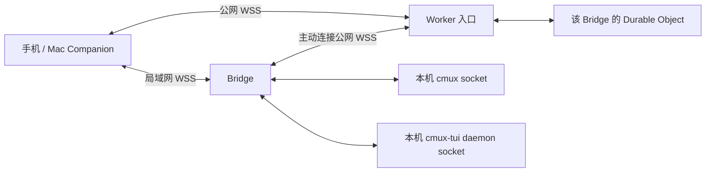

# 统一 WebSocket 协议与 Cloudflare 中转方案

状态：首轮代码已实现，公网部署与完整验收未完成。更新时间：2026-10-13。

本文保留设计合同。当前实现及执行过的检查见下方进度记录；
未列为已实现的合同条目仍是后续工作，不能作为已完成能力。

## 1. 目标与当前状态

手机在局域网内直接连接同一台 Mac 的 Bridge；离开局域网后通过 Cloudflare
连接这台 Bridge。两种路径使用相同的消息、配对身份、工作区权限和操作回执。
手机和 Mac Companion 共用连接层，使用者不需要维护两套配对或选择协议模式。
Bridge 同时承接本机 cmux 和本机 cmux-tui daemon 的会话。

当前直连是 HTTPS 请求与手机前台定时刷新，不是 WebSocket。现有连接 v2
已经实现主机与设备 Ed25519 身份、主机 TLS 证书固定、Mac 主人审批、按设备
撤销、工作区权限、请求签名与操作回执。详见 [Connection v2](CONNECTION-V2.md)。

本次只改外围项目，不修改或替换官方 cmux，不重新连接 Claude/Codex API，
不新建 Agent 运行时，不在手机上增加终端。云端不保存聊天或附件，不执行
命令，也不在 Bridge 离线时排队等待执行控制操作。

## 2. 拓扑与职责



- **Worker**：校验升级请求，限制接入频率，按主机 ID 路由到 Durable Object。
- **Durable Object**：每个 Bridge 身份一个对象，接收一条 Bridge 连接及多个
  客户端连接，按通道 ID 定向转发；保存恢复路由所需的最少元数据。
- **Bridge**：维护出站中转连接，验证端到端身份，处理配对与授权，调用已有
  SessionService/BridgeRouter 和后端适配器。
- **客户端**：连接、握手、请求关联、订阅、附件分块、掉线恢复与线路选择。

Bridge 和客户端均主动建立到云端的连接。Durable Object 不向内网 Bridge
发起连接，因此无需公网 IP、端口映射或 cloudflared 进程。

云端实现放在本仓库的 `cloudflare/`，使用 TypeScript、Workers 和 SQLite
Durable Objects。Swift 端保留现有语言和部署方式，不混入官方 cmux 云服务。

## 3. 一套协议，两条传输路径

业务消息协议暂定为 `cmux-link/3`，WebSocket 子协议暂定为 `cmux-remote.v3`。
直连接口暂定为 `/v3/link`；中转入口暂定为 `/v3/relay/<host-id>`。
路径名须在实际接入前与 Worker、Bridge、客户端的同一版合同对齐。

直连发送端到端加密包；中转转发同样的加密包。Bridge 的云端连接额外携带
`channel_id`、`open/data/close` 路由外壳，用于区分多个手机。通道 ID 由中转
分配，不能让一个手机自行选择另一个手机的通道。Bridge 将回复发回对应
通道，不广播历史、文件、附件或操作回执。

解密后的消息：

| 类型 | 合同 |
| --- | --- |
| `request` | 请求 ID、固定资源 method/URI、现有请求签名、业务 body |
| `response` | 原请求 ID、状态码、媒体类型、分块序号、内容、结束标记 |
| `subscribe` | 订阅 ID、允许订阅的只读资源、当前设备签名、可选游标 |
| `event` | 订阅 ID、Bridge epoch、序号、资源变化或需重新读取的通知 |
| `cancel` | 取消本连接自己的读取或订阅；不能取消其他设备的请求 |
| `blob` / `ack` | 绑定请求 ID 的有界二进制分块及流量确认 |

历史、发送、停止、审批、图片、文件、Git 和镜像资源复用原来的 DTO 与固定
路由。不会把手机提交的任意方法直接转成 cmux/daemon RPC。旧 `/v2` HTTP
接口在迁移期间保留；显式 legacy bearer 模式继续仅按原合同工作，不接入
公网中转。v3 是否可用须明确协商，不能在不确定的写入之后降级重发。

`request_id` 标识一次传输请求；`operation_id` 标识一次逻辑修改。后者在
断线、跨路径和重启时保持一致，不能用新的传输请求 ID 替换。

## 4. 身份与端到端加密

Cloudflare 的公网 TLS 证书只证明中转入口身份，不能代替手机已信任的
Bridge 主机身份。手机始终核对保存的主机 ID、公钥和原主机证书身份。
直连继续固定主机 TLS 证书；中转 WSS 使用正常的系统 PKI 校验，业务内容
在 WSS 内另外端到端加密。

初步选型：CryptoKit 的 RFC 9180 **authenticated HPKE**，采用
`P256_SHA256_AES_GCM_256`。本机 SDK 声明支持 macOS 14 / iOS 17，符合当前
最低系统版本。加密原语由 CryptoKit 提供；身份认证与握手合同仍需要专项
验证，不能因为使用标准原语就声称整个协议已通过安全验证。

计划握手：

1. 客户端为本次连接生成临时 P-256 密钥，使用自己的 Ed25519 身份签署
   主机 ID、客户端公钥、临时公钥、协议版本、随机 nonce 和时间。
2. Bridge 校验签名和目标身份，生成本次连接的临时密钥与 nonce，签署
   完整客户端提案的摘要、主机身份、自己的临时公钥和协议版本。
3. 客户端用已信任的主机公钥校验回复，确认回复对应本次提案。
4. 双向分别建立 authenticated HPKE 上下文；`info` 绑定完整握手摘要、
   协议和方向。双方的临时公钥先经身份签名认证，再用于 HPKE sender auth。
5. 第一包携带 encapsulated key；之后严格按上下文顺序收发，不允许中途
   重置上下文。重连必须生成新的临时密钥和上下文；密钥不进入磁盘或日志。

握手完成只建立受认证通道，不授予工作区权限。每个业务请求仍携带原 v2
签名并检查当前授权。请求证明里的 client ID 必须与通道认证的设备一致。
订阅与二进制分块也绑定该设备、该连接和请求 ID。

Cloudflare 可以观察主机/设备路由标识、连接状态、时序及数据长度；按照
此设计不能读取聊天、输入、文件、附件和审批内容。内容不写入 Worker 日志、
DO 存储、KV、D1 或 R2；排错只记录有界错误码及非敏感统计。

## 5. 中转注册与配对

Bridge 首次注册中转需要部署级 `BRIDGE_REGISTRATION_KEY`，以及对主机
注册挑战的身份签名。部署密钥只保存在 Worker secret 与 Mac 私有文件中。
它不是 Cloudflare API token，也不是手机的业务访问凭证。

客户端入站不能仅凭主机 ID 建立无限连接。采用两类主机签名的接入凭证：

- **待配对**：短期 enrollment window 的中转接入许可，随主机签名 QR
  提供，仅允许在窗口有效期间接入。手机仍需以自己的密钥证明身份，Mac
  主人仍需批准精确请求，云端不代为批准。
- **已配对**：批准后签发最小中转接入证明，绑定主机、客户端公钥、中转
  origin、凭证版本及凭证 ID。它不包含工作区权限、会话数据或永久共享密钥。
  持有证明的人还必须证明拥有对应设备私钥。

每次入站使用新的挑战/nonce；云端验证签名、防止重放并限制待配对连接数。
部署密钥不能出现在二维码、URL 查询参数、手机存储或日志里。签名验证必须
共享明确的 JSON 编码和 domain separation 合同，不能由 TS/Swift 各自猜测。

手机扫码后仍按“请求访问 → Mac 主人批准 → 自动连接”的现有流程运行。
桥接端点增加可选 relay origin 和接入证明，旧保存记录缺少这些字段时仍能
读取。旧设备不会自动获得新权限；加入中转地址也不扩大原工作区 scope。

撤销以 Bridge 注册表为准：立即拒绝该设备的请求和订阅，终止对应通道，
并通知中转撤销路由许可。通知丢失时云端可能仍容许建立传输，但 Bridge
必须拒绝业务访问；不得把云端许可当成最终授权。

部署方需要 Cloudflare 账户；手机用户无需注册 Cloudflare 或 cmux 云账号。

## 6. 自动选择与故障恢复

保存主机身份与可用端点，连接时先尝试局域网，连接建立失败才尝试中转。
初始连接 deadline 计划为每条路径 4 秒，可按实测调整。

仅网络不可达、连接超时等可触发线路回退。身份、证书、签名、协议版本或
授权失败须明确报错，不能通过换一条线路掩盖异常。

当前连接正常时不因发现更快路径而迁移正在执行的操作。首次连接成功后，
同一客户端对象持有该连接；之后重连可重新选路。线路变化不变更主机身份、
设备身份、grant 或操作回执命名空间。

断线处理：

- 读取：取消旧请求，在新连接重新读取。
- 订阅：携带游标恢复；Bridge epoch 改变或缓存缺口则重新获取快照。
- 修改：旧请求进入“结果未知”，查询原 operation ID 回执，不自动执行第二次。
- Bridge 离线：立即返回离线状态，不把发送、停止、审批留到上线时执行。
- 手机退后台：取消前台订阅；回前台先读取，再建立订阅。

WebSocket 不能保证手机在后台常驻。本阶段不承诺后台持续接收或离线推送；
如要后台审批通知，需要另行设计 APNs，不能靠保持 WebSocket 代替。

## 7. 更新、订阅与附件

先用订阅替换手机的两秒轮询。订阅初版可发送“资源变化，需要刷新”的通知，
客户端再读取权威快照；无需第一版就实现完整增量聊天事件协议。

Bridge 的底层观察：已有 cmux 事件流触发失效与刷新；本地 JSONL 完整行
追加触发历史变化；缺少事件的 daemon/屏幕预览由 Bridge 有界观察。相同
资源摘要不重复推送。打开中的会话和 Feed 才订阅，不为每个历史会话持续读屏。

订阅先注册观察再完成初始快照边界，避免遗漏变化；每次读取和最终发布前
重新检查 scope、撤销与会话绑定。未授权工作区变化不得进入该设备的事件。
游标缓存只保留有界序号/失效元数据；缓存不足时明确要求重读，不谎称完整回放。

换成 WebSocket 后实时预览仍取决于已有后端能力，不等于 provider token
级输出。已提交 JSONL 历史仍为权威来源，屏幕预览仍可替换。

PNG/JPEG 上传与图片读取走同一加密链路，复用当前校验、数量和总量限制。
响应和二进制传输分块，避免大图片或历史阻塞所有控制请求。blob 必须绑定
精确请求、媒体类型、总长度、分块顺序和摘要，取消/超时清理未完成资源。
Bridge 的 Agent 附件文件继续留在本机受限缓存，不上传 R2。

## 8. Cloudflare 运行约束

两端都以客户端身份连入 DO，由 DO 调用 `acceptWebSocket` 接受，使用
Hibernation API。不能让 DO 主动拨号到 Bridge，因为 outgoing WebSocket
不能休眠。连接角色和通道关系用 `serializeAttachment` 恢复；不要依赖只
存在于内存的路由表。不能用 DO 内 `setInterval` 持续保活破坏休眠。

连接保活优先用协议 Ping/Pong 或自动应答机制；本地 Ping 成功只证明到
Cloudflare 这一跳存活，Bridge 是否在线要根据实际 Bridge 通道判断。
运行时更新和部署仍可能断开连接，因此两端都要实现有界重连与状态恢复。

首版计划限制（两端及 DO 都须执行）：

| 项目 | 首版上限 |
| --- | --- |
| 每主机 Bridge 连接 | 1 条；替换必须证明同一主机身份，拒绝旧连接继续发包 |
| 每主机已配对客户端 | 16 条 |
| 待配对客户端 | 4 条且短期超时 |
| 每客户端并发资源请求 | 8 个 |
| 每客户端活动订阅 | 8 个 |
| 资源请求 body | 继续最多 1 MiB |
| 一个资源响应 | 继续最多 8 MiB |
| 业务数据分块 | 最多 64 KiB，有界发送窗口与确认 |
| 端到端包 / 云端路由外壳 | 最多 2.1 MB / 3 MB，计入编码开销 |
| 一条连接待发送总量 | 最多 8 MiB；慢消费者关闭并重新同步 |

Cloudflare 官方 DO 接收消息上限为 32 MiB；不能因此把应用上限也设到 32 MiB。
入站限流须同时覆盖无效升级、握手与数据消息；防重放表、待批准连接和路由
记录都必须有容量限制。超过限制明确拒绝，不能丢掉旧安全状态来接纳新请求。

首版不需要外部数据库。DO SQLite 仅用于最小主机注册/接入撤销元数据；
活跃连接附件只描述路由与角色。实现时须证明慢消费者不会造成无界积压，
不能把 WebSocket `send` 完成当成手机已经消费。

## 9. 修改范围与步骤

先写合同与共享 DTO，再实现直连，最后接入云端。聊天界面、附件选择、停止
按钮和审批页面复用；连接设置只添加必要的中转配置和实际连接状态。
新增设置、状态和错误提示进入现有英文/简体中文资源，服务端继续只暴露稳定错误码。

| 阶段 | 代码范围 | 完成条件 |
| --- | --- | --- |
| A. 协议 | Core 消息、握手、端点迁移与错误码 | 合同和编解码一致，权限与数据边界明确 |
| B. 直连 | Bridge NIO WebSocket、共享客户端 | 现有资源操作走新链路，HTTP 迁移路径保留 |
| C. 中转代码 | cloudflare Worker/DO、Bridge 出站服务 | 包含可部署配置与限流，可在本地打包 |
| D. 连接配置 | CLI/owner 配置、扫码端点、客户端选路 | 一次配对可用两条路径，旧记录兼容 |
| E. 订阅 | Bridge 观察与共享客户端、前台页面生命周期 | 同时序初始快照和订阅，撤销/后台及时取消 |
| F. 部署验收 | Cloudflare 实际环境与两端设备 | 直连、公网、断网、重连与结果未知流程有证据 |

当前代码支持的启动参数：

```sh
cmux-remote serve --relay https://YOUR-RELAY.workers.dev \
  --relay-key-file /absolute/private/path/relay-registration-key --pair
```

relay origin 仅接受合法 HTTPS origin，拒绝 URL 用户信息、查询、片段和任意
路径。密钥文件要求同用户、私有权限，不能把密钥作为命令行明文参数。
菜单栏 resident 的中转配置使用同一服务入口，重启后恢复；关闭远程访问
须关闭 LAN 和中转业务通道，不能只停 LAN 留云端继续访问。

## 10. 稍后需要用户准备的东西

先完成 Worker、Wrangler 配置、Bridge/客户端代码与部署指南，再请用户准备：

1. 注册并登录 Cloudflare，开通 Workers；免费计划的 SQLite DO 可先试跑。
2. 在自己的机器执行 `wrangler login`，不把账户 API token 发到聊天里。
3. 创建一个随机注册密钥，通过 `wrangler secret put BRIDGE_REGISTRATION_KEY`
   放入 Worker，并在 Mac 的私有文件保存同一个值。
4. 执行部署，将最终 Worker HTTPS origin 填入 Bridge。
5. 在 Mac 打开配对二维码，手机扫码并由 Mac 主人批准，完成公网实测。

无需现在注册；还没有执行 `wrangler deploy`，没有创建 Cloudflare 资源，
没有产生该功能的云端费用。Worker 可开源并由使用者部署到自己的账户。

截至资料核对日，Workers Paid 基础费用为 $5/月，DO 超额请求、执行时长与
存储单独按用量计费。休眠减少空闲时长费用，不等于总费用一定只有 $5。
免费额度超限会失败，不能承诺生产无中断。上线指南须记录实测用量和配额。

## 11. 验收清单与待验证项

本节定义后续验收，并非已经执行的测试。按仓库要求，只在用户明确要求
验证或打包期间运行对应检查；文档提交本身不触发构建或测试。

- 同一设备直连和中转看到同一授权会话，操作走同一处理入口。
- cmux 与 daemon 混合场景保持工作区隔离；旧设备权限不扩张。
- 主机冒充、客户端冒充、握手/消息重放、串通道、改包均失败关闭。
- 历史、附件、停止、审批、文件、Git 的结果与原 API 一致。
- 撤销后的请求、读取结果和订阅事件都停止；云端许可不能绕过撤销。
- 掉线发生在写入前、写入后、回执丢失时，均不会自动重复执行修改。
- 初始订阅竞态、缓存缺口、Bridge 重启、DO 休眠恢复和部署重连可恢复读取。
- 请求取消、退后台、大响应、慢消费者与消息洪泛不造成无界内存/任务。
- 不可达、身份失败与权限失败明确区分；只对网络不可达切换线路。
- Mac 停止远程访问后，局域网和中转都不再暴露业务资源。
- 实机从 Wi-Fi 切到蜂窝可连接；不会把本机模拟验证当作蜂窝公网验证。

加密握手合同、TS/Swift 签名兼容、DO 休眠时的路由恢复、慢消费者背压、
实际账户地域网络可达性都尚未验收。下一阶段不能只完成 Worker 就宣称
直连/中转统一改造完成。

## 参考资料

资料核对日期：2026-10-13；价格与平台限制在实际部署前再次核对。

- [现有连接、身份与授权合同](CONNECTION-V2.md)
- [daemon 适配范围](CMUX-TUI-ADAPTER.md)
- [Cloudflare DO WebSocket 与 Hibernation](https://developers.cloudflare.com/durable-objects/best-practices/websockets/)
- [Cloudflare WebSocket 生命周期](https://developers.cloudflare.com/workers/runtime-apis/websockets/#connection-lifetime)
- [Cloudflare DO 限制](https://developers.cloudflare.com/durable-objects/platform/limits/)
- [Cloudflare DO 计费](https://developers.cloudflare.com/durable-objects/platform/pricing/)
- [Cloudflare Workers 计费](https://developers.cloudflare.com/workers/platform/pricing/)
- [Apple CryptoKit HPKE](https://developer.apple.com/documentation/cryptokit/hpke)
- [RFC 9180](https://www.rfc-editor.org/rfc/rfc9180.html)

## 当前实现与提交时的证据

截至本次提交，已接入：

- LAN `/v3/link` 与 Cloudflare 中转复用 authenticated HPKE 消息和固定资源路由。
- 请求关联、每设备请求证明、响应 64 KiB 分块与按序 ACK（每个响应最多 4 块未确认，乱序或超前确认即断开链路）、慢消费者 deadline。
- 手机上次经中转连通时，下次同时拨 LAN 与中转，先完成认证者胜出；LAN 的身份或证书错误仍终止本次连接。
- 中转房间与目录创建在 `wnam`（美西）区域，名称带 `wnam:` 前缀以便按新位置重建。
- 公网出站 Bridge、SQLite DO 注册与接入证明、nonce 防重放、连接/帧/速率限制。
- LAN 建连不可达时尝试中转；修改操作不自动重发，继续使用原操作回执。
- 历史/预览/Feed 订阅失效通知，退后台取消，网络恢复后重新读取与订阅。
- Mac 原生中转设置、owner 配置、私有密钥文件、resident 配置恢复和停止双路径。
- QR 中转配对与批准后的设备证明；已配对 iPhone 可刷新并保存主机签名的路由提示。

执行过的检查：

- 一次全量 Swift 测试执行 257 个测试、52 个 suite，全部通过。该次 `verify.sh`
  后续手机状态检查失败：可选路由提示读取影响 Feed-only 的模拟场景。修复后
  单独手机状态检查通过；最终修改后没有再运行完整验证脚本。
- 后续 7 个直连/真实 Cloudflare 本地运行时/边界测试通过，包括实际多块响应、
  6 个并发读取、操作回执去重、订阅撤销、跨握手借用请求证明拒绝、慢消费者
  deadline。最初大文本会被历史阅读器裁剪；已改为多个记录并通过分块断言，
  不以长输入字数作为实际多块传输的证据。
- Worker TypeScript 与 Wrangler dry-run 打包通过；两个真实 SQLite DO 测试通过，
  覆盖独立通道、接入撤销、重放、借用许可和过期窗口。
- Mac app/helper 编译与签名通过，iOS 目标编译通过。后续仅 AppModel 可选提示
  错误处理及测试 fixture 修改未重新做原生构建。
- 独立测试版 Mac 设置窗口已实际打开并检查中转配置行，沿用原生表单布局；
  未修改用户运行中的 cmux，测试进程已在提交时清理。

按用户要求先提交代码，停止进一步验收。尚未完成：公网 Cloudflare 部署、
蜂窝/真机/两 Mac 验收、DO 生产休眠恢复验收、加密协议外部审计。
上传仍复用现有有界请求 body；独立 blob 上传消息尚未实现。订阅当前采用
初始失效通知和权威快照重读，尚未实现独立持久事件游标缓存与增量回放。
这些限制不应被测试名称、编译成功或 dry-run 打包表述为已经完成。

### 续做记录（2026-10-13）

修复三个会在真实使用中出现的竞态。每个都先写出能复现的测试，确认在旧代码上失败，修复后通过：

- **取消一个订阅会把同一链路上正在发送的消息变成“结果未知”**（离开页面时最常见）。Bridge 端
  `finish` 在单个请求被取消时关闭了整个会话；现在只结束该请求。
- **取消一个多分块读取会中断同一链路上的其他读取。**客户端把已取消 ID 的迟到响应/事件当成
  协议错误并断开链路；现在忽略最近 64 个已取消 ID 的迟到帧，其他未知 ID 仍判为错误。
- **一个已撤销或已关闭通道的迟到数据包，会让 Bridge 断开整条中转连接**，所有手机一起掉线；
  重复或超额的 `open` 同理。现在只向该通道回 `close`。中转 socket 抽象为
  `CloudRelayConnecting`，用脚本化的云端对端做确定性测试。
- 确认空闲链路超过 4 秒握手超时后仍然可用（`timeoutIntervalForRequest` 只约束握手）。

部署准备：Worker 与 Miniflare 的 `compatibility_date` 对齐到锁定运行时的 2026-10-06，避免部署时
因日期超前被拒；新增 `scripts/deploy-relay.sh`，登录后一步完成密钥生成、部署和 secret 设置，
密钥只经文件和 stdin 传递。

本轮检查：`scripts/verify.sh` 265 个 Swift 测试（55 个 suite）及手机/本地化/发布检查全部通过；
`scripts/verify-relay.sh` Worker 类型检查与 dry-run 打包、2 个 SQLite DO 测试、13 个 Swift 链路/中转
测试通过；iOS 与 Mac 原生构建通过。

仍未完成（需要部署方/真机）：公网 Cloudflare 部署、蜂窝网络与真机验收、DO 生产休眠恢复、
加密协议外部审计。独立 blob 上传和持久事件游标仍按第 7 节作为后续工作；上传沿用 1 MiB
请求体上限，与原 HTTP 接口一致，没有收紧。

### 中转目录、多台 Mac 与唯一 Bridge（2026-10-13）

- **中转目录（在线即可见）**：Bridge 的中转在线时，维持一个自动续期的"目录配对窗口"（每个窗口 10 分钟，
  每 4 分钟续期，最近两个窗口同时有效），并把带主机签名的配对信息发布到 `GET /v3/directory`。Worker 只接受已
  注册主机发布自己的条目，并用登记的主机公钥验证签名和配对许可；Bridge 离线或停止中转时条目撤下。手机对每条
  结果像扫码一样重新验证，伪造或格式错误的条目直接丢弃。目录申请默认请求这台 Mac 当前的全部工作区，Mac 主人
  批准时可以逐个取消勾选；批准永远不会超出申请范围。扫码窗口不再作废目录窗口里的待批准申请，短暂断线重连也不会。
- **手机多台 Mac**：已认证的 Mac 按主机身份分别保存，旧的单台记录自动迁移。对话按 Mac 分组合并显示，一台
  Mac 读取失败只影响它自己；侧边面板列出全部 Mac，可添加或单独移除。添加设备页同时列出局域网和中转发现的 Mac。
- **每台 Mac 只运行一个 Bridge**：`serve`/`resident` 启动时获取本用户范围的机器锁
  `~/.local/state/cmux-remote-bridge.lock`，第二个实例以 `bridge_already_running` 拒绝启动。
- **链路请求名额**：客户端收到最后一块即释放名额；Bridge 原先要等投递任务再次运行才释放，负载高时会把客户端
  合法的第 8 个请求判为非法并关闭整条链路（CI 上稳定复现为 "Socket is not connected"）。现在 Bridge 在收到最后
  一块确认的同一步释放名额，CI 连续两次通过。入站缓冲也改为按字节上限（64 帧、8 MiB），不再积压 8 帧就断开。

验证：`scripts/verify.sh` 271 个 Swift 测试（59 个 suite）及手机状态（含 7 项多 Mac 检查）、本地化、发布检查
通过；`scripts/verify-relay.sh` 3 个 Worker 测试与 14 个 Swift 链路/中转测试通过，其中端到端测试覆盖"手机无二维码、
不在同一网络，经中转目录发现 Mac、申请、主人收窄后批准、经中转读取，停止后从目录消失"；GitHub CI（Xcode 26.3）
`verify.sh`、iOS、Mac 构建全部通过。公网实测：部署后的 Worker 目录已列出这台 Mac（名称、工作区数和过期时间正确）。
未验证：真机经中转目录申请与批准的完整操作。
